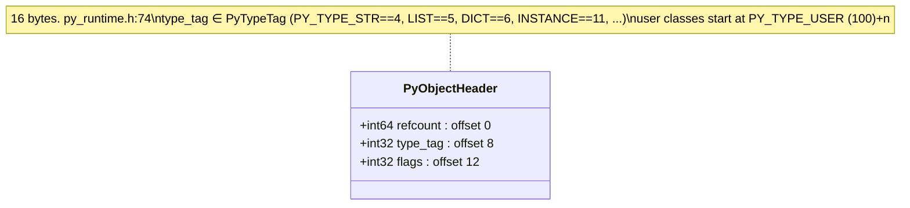
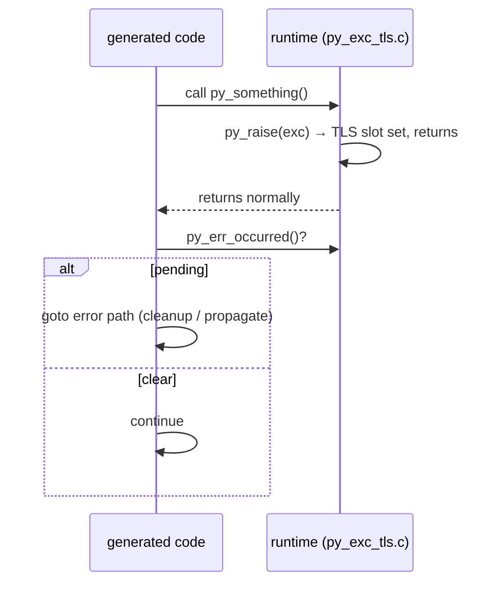

# 04 · Runtime Object Model & GC

The runtime is what pcc-compiled Python links against. It is written in pcc-Python under `pcc/runtime/py/*.py` and compiled by pcc itself into `libpy_runtime_pcc_py.a` (this is what makes the runtime part of the self-host story). The C implementation was removed; `pcc/runtime/src/` keeps only a few headers, and `py_libpython.c` remains as the cpython-compat bridge. Modules named `freestanding_*` (collectors, allocator, threads) use no Python object model of their own and export every function through `@c_abi_export`. The object-header and class-layout notes below still cite the historical C headers.

## Object header (every heap object)



- Header layout: `py_runtime.h:74`. Type tags `enum PyTypeTag`: `py_runtime.h:14` (`NONE=0, BOOL=1, INT=2, FLOAT=3, STR=4, LIST=5, DICT=6, TUPLE=7, SET=8, FUNC=9, CLASS=10, INSTANCE=11, EXC=12, …, VALUEBOX=200`; user classes `PY_TYPE_USER=100 + n`).
- Flags `py_internal.h:13` — `IMMORTAL`, `GC_TRACKED`, `FINALIZED`, plus per-backend GC color/age bits (`GC_WHITE/GRAY/BLACK`, `GC_YOUNG/OLD/REMEMBERED`, `GC_RELOCATION_*`, `GC_ZPAGE_ALLOC`). Under `PCC_WITH_THREADS=1` these go through atomic accessors (`py_internal.h:34`); default build is non-atomic.

## Class & instance layout

`PyClassObject` is **120 bytes** (`py_internal.h:406`), mirrored exactly in `py/py_class.py`. Layout drift between the two is a recurring bug class, so the offsets are pinned:

| offset | field | offset | field |
|---:|---|---:|---|
| 0 | header (16B) | 64 | `methods` |
| 16 | `name` | 80 | `field_names` |
| 32 | `bases` | 88 | `instance_size` |
| 48 | `mro` (C3) | 96 | **`del_method`** |
| 56 | `n_methods` | 104 | **`attrs`** |
| 92 | `type_tag_alloc` | 112 | **`metaclass`** |

Built `pcc_gc_alloc(sizeof(PyClassObject), PY_TYPE_CLASS, 0)` at `py_class.c:351`; MRO via C3 linearization.

## Exception model — return-code, **no stack unwinding**

There is no Itanium-style unwinding. `py_raise(exc)` stashes the exception in a thread-local slot and **returns normally**; generated code must check `py_err_occurred()` after any call that can raise and branch to its error path. Missing that check turns into "compiled fine, produced no output".



- `py_raise()` `py_exc_tls.c:114` (normalizes, sets `__context__` chaining, stores in TLS); `py_err_occurred()` `:152`; `py_current_exception()` `:157`; `py_clear_exception()` `:162`.
- `PyExceptionObject` carries `exc_class`, `message`, `cause`, `context`, growable `traceback` (`py_internal.h:720`). Builtin exception tags at `py_runtime.h:51` (`VALUEERROR=2, TYPEERROR=3, KEYERROR=4, …`).

## Garbage collection: current architecture

Verified against source at `4de52048c` (2026-11-15). Function and file names
are the authority; re-check them before relying on a line here.

### Selection

`PCC_GC_BACKEND=0..4` is read once and fixed for the process
(`pcc_gc_fix_backend`, `pcc/runtime/py/py_gc_backend.py`); nothing switches
`pcc_gc_backend_selected` afterwards. Every backend other than 0 sets
`pcc_gc_backend4_no_refcounts=1`, so GC1-GC4 run one shared count-free
protocol and differ only where a section below says so. Each collector's
reference implementation is kept under `docs/refs_docs/`
(`cpython_gc.c`, `lua_lgc.c`, `lua_manual_5.4.html`, `go_mgc.go.html`,
`go_gc_guide.html`, `openjdk_jep439_zgc.html`, and `gc-research/`).

### Barriers and stores

- `pcc_gc_load_ptr(owner, slot)` reads a slot (GC4 resolves forwarded
  objects through `pcc_gc_note_relocation_read`).
- `pcc_gc_store_ptr` / `pcc_gc_store_field_ptr` (instance fields) write a
  slot: GC0 counts the new and old values; GC1-GC4 shade for the marker. GC0
  stores take inline atomic owner fast paths (`_gc0_owner_fast_path` in
  `py_obj.py`); fields and containers take their own container lock when
  `pcc_gc_list_container_mode` is set, the graph lock otherwise.
- `pcc_gc_store_root` writes a root slot (frame, global, temporary root).

### GC0: reference counting and a cycle collector (CPython)

- Atomic reference counts (`pcc_gc_refcount_atomic`, set for backend 0
  without the provenance probe). A count reaching zero runs `__del__` and
  frees at once, on the releasing thread.
- Cycle collector `_collect` in `freestanding_gc_backend0_collector.py`:
  stop the world, take the default table lock, compute each tracked node's
  count minus its internal edges, mark from the positive ones and the
  runtime roots; the rest is the unreachable batch. Each batch member is
  held (one reference, `_COLLECTOR_HELD`, discounted by both recomputes);
  weak links are cleared and callbacks queued
  (`py_weakref_queue_gc0_candidates`); if any callback or finalizer must run
  (`py_user_del_pending`), the table lock and the world are released while
  they run, then the world stops again and reachability is recomputed
  (resurrection). Refs without callbacks are cleared late
  (`py_weakref_clear_gc0_candidates`), referents are cleared, members are
  freed, and survivors drop their hold after the world resumes.
  `py_gc_collecting` keeps other GC0 collections out meanwhile.

### GC1-GC4: the shared count-free protocol

1. **Allocation.** Object cells come from 64 KiB allocator object slabs
   with size classes and per-thread magazines (`freestanding_allocator.py`).
   A slab with registered cells has a record array (a cell's GC node is its
   slab record) and a GC page with two mark bitmaps, one bit per cell,
   alternating per mark (`freestanding_gc_page_marks.py`). Registration is
   staged in per-thread rings outside the graph lock
   (`freestanding_gc_alloc_stage.py`). Raw, large and static objects have no
   page and keep their colour in the object header.
2. **Marking.** A background collector thread
   (`pcc_gc_maybe_start_cms_worker`, started for every backend 1-4) drains
   the gray worklist (`freestanding_gc_gray_worklist.py`,
   `docs/gc-gray-worklist.md`). Mutators shade through barriers and assist
   when their allocation debt outruns the marker; pacing is Lua-style
   `pause` / `stepmul` over the last mark's live bytes
   (`freestanding_gc_incremental_concurrent_scheduler.py`).
3. **Roots.** Precise stack maps of compiled frames
   (`freestanding_gc_mapped_roots.py`), registered frames and root slots
   (`freestanding_gc_frame_registry.py`, `freestanding_gc_root_registry.py`),
   conservative words of every thread's stack snapshot
   (`freestanding_gc_conservative_roots.py`; snapshots in
   `freestanding_thread_kernel_pthread.py::_thread_snapshot_roots`), and
   runtime globals.
4. **Finish** (`pcc_gc_finish_tracing_cycle`,
   `freestanding_gc_common_mark_cycle.py`, stopped world): final remark;
   every unmarked object gets the sweep-candidate flag (`1024`), and on
   GC1-GC3 the finish seals a candidate list
   (`pcc_gc_tracing_candidates_reset/note/seal/retire`) that the sweep visits
   instead of every object.
5. **Sweep** (`pcc_gc_tracing_sweep_unreachable`,
   `freestanding_gc_tracing_sweep_collector.py`, called by
   `pcc_gc_collect_tracing` in a stopped world):
   - recheck reachability when the finish happened in an earlier stop;
   - clear weak links to candidates and queue their callbacks
     (`py_weakref_queue_tracing_candidates`); run the callbacks with the
     world resumed, stop again, recheck;
   - select PASS0 targets, the candidates whose finalizer runs user code
     (`py_user_del_pending`: `__del__`, a suspended generator's close), and
     run them with the world resumed;
   - stop again: recheck (resurrection), clear refs without callbacks late
     (CPython 3.15 order: callback refs die before finalizers, plain refs
     survive them), PASS1 clears referents (count-free: nothing released),
     PASS2 frees. Plain dead objects may be left to the collector thread
     (`pcc_gc_concurrent_sweep_slice`; `docs/gc-deferred-free.md`,
     `docs/gc-scalar-sweep-retirement.md`).
   While the world runs user code, `pcc_gc_explicit_collect_active` stays
   set: `gc.collect()`, automatic collections and GC4 steps stand aside, and
   the scheduler begins no mark unless its caller holds the stopped world.
   Exception: GC4 runs its sweep's user code in the stopped world. Resuming
   it mid-sweep ran some objects' `__del__` twice and others' never on the
   four-thread field program (GC1-GC3 stayed exact); the cause is not
   established (a guard on unsettled relocation did not remove it). A GC4
   finalizer can therefore still deadlock on a lock a parked thread holds;
   the planned fix is deferred finalization (keep the targets and their
   referents alive, finish the sweep and the relocation, run the finalizers
   after the world resumes, reclaim them in the next collection).
6. **Stopping the world.** `pcc_stop_the_world` / `pcc_resume_world` nest
   by depth; each outermost stop takes a new epoch
   (`pcc_thread_world_stop_epoch_held`). Compiled code polls
   `pcc_thread_stop_requested` and `pcc_gc_gray_worklist_flush_requested`
   with a plain (monotonic) load; the slow path acquires. Threads blocked in
   the kernel publish a stack snapshot and count as parked.
   `pcc_thread_world_release_held` / `pcc_thread_world_reacquire_held`
   resume a held world at every depth and restore it, for user code.
7. **GC4 relocation.** In a stopped world GC4 selects object slabs by live
   density (`freestanding_gc_relocation_selector.py`, page live bytes),
   copies their cells into fresh slabs (`freestanding_gc_relocation_copy.py`,
   `freestanding_gc_relocation_drain.py`), records forwarding
   (`freestanding_gc_forwarding_identity.py`) and rewrites every reference
   before the world resumes (`pcc_gc_relocation_settle_stopped`).

### The five collectors today, against the approved design

The design approved on 2026-11-12 gives each collector one capability over
the shared protocol. Only the shared layer and GC4's first evacuation phase
exist:

| Collector | Approved reference design | Today |
|---|---|---|
| GC0 | CPython refcount + cycle collector | as designed |
| GC1 | Lua 5.4 incremental (manual 2.5.1): mutator-paced steps, **no** collector thread | shared protocol, with the background marker thread |
| GC2 | Go: background mark workers, mutator assists, heap-goal pacer | shared protocol; no pacer or assists of its own |
| GC3 | Lua 5.4 generational (manual 2.5.2; `lua_lgc.c` ages `G_NEW` -> `G_SURVIVAL` -> `G_OLD1` -> `G_OLD`, `G_TOUCHED1/2`): non-moving, minor collections, occasional major | shared protocol; no young generation (`pcc_gc_backend3_young_link_head` has no caller; `36d5c85bc` removed the unreachable young machinery) |
| GC4 | Generational ZGC (JEP 439): GC3's generations, young slab evacuation, dense slabs aged in place, old relocation by density | shared protocol + stopped-world slab evacuation (`f4ce17764`, `6bda7e915`); `PAGE_GENERATION` exists but nothing sets it |

### Remaining work, in order

Each step is test-first, runs native programs against CPython on all five
collectors, measures with a five-pair `pcc_perf.py` A/B against an
unchanged control, and is its own commit. Four workers must never be slower
than one, for every collector.

1. **GC3 generations.** Mark new cells young (page bit or header age bits);
   a minor collection marks from the roots and the touched old objects only,
   sweeps young cells, and ages survivors (`G_SURVIVAL`, `G_OLD1`, `G_OLD`).
   A barrier on old-to-young stores marks the old object touched (Lua's back
   barrier). A major collection runs when old growth exceeds the
   `genmajormul` share. Acceptance: young objects die in minor collections
   without a full mark (count the objects a minor visits), all five-GC
   finalizer/weakref suites unchanged.
2. **GC4 phase 2.** Set `PAGE_GENERATION` (slabs age by survived
   collections); evacuate young slabs in each minor; age dense slabs in
   place; relocate old slabs by density in majors; record old-to-young
   stores (store buffer) for the minor's roots.
3. **GC1 incremental.** Start no collector thread for backend 1; drive the
   mark from allocation debt in bounded mutator steps (pause / stepmul) and
   finish and sweep on the stopping mutator. Acceptance: no collector thread
   exists under GC1.
4. **GC2 pacer.** Give GC2 its own heap-goal pacer (next goal = live x
   (1 + GOGC/100)), background workers sized as a fraction of the cores, and
   assists proportional to allocation against the goal.

### Known open defects (2026-11-14/15)

- The stopped world's owner snapshots its own stack from its current frame,
  so the collector's own frames (sweep, recheck, mark) are scanned
  conservatively; a stale candidate address there keeps the candidate
  alive (`tests/python/test_gc_tracing_sweep_verdict_native.py`
  `partial-budget-finalizer-once`, rc 142; layout dependent since
  `cfa9366c2`). Fix: capture the registers at the collection's entry and
  scan the owner from there (as Boehm GC does); cutting the stack without
  the registers loses callee-saved pointers.
- `gc.collect()` on GC1-GC4 counts non-cyclic garbage
  (`gc-start-callback`, rc 143: 5 instead of CPython's 0).
- GC1-GC4 do not finalize at once what CPython's reference counting frees
  at once: `test_vthread_callback_exception_disposal`,
  `test_exact_int_attr_receiver_release` (GC1 `392 9`),
  `test_slot_call_min_max_producers` five-GC case.
- `test_gc4_field_direct_store::test_field_direct_store_keeps_scalar_ir_and_opaque_plan`
  expects the StorePlan commit inlined into `pcc_gc_store_field_ptr`.

### Measuring

All runtime measurement goes through `scripts/pcc_perf.py` (its docstring is
the manual); arms, caches and the ledger live under `PCC_PERF_HOME`, outside
the repository. Measure only with no build or test running, on an idle
machine.

```bash
export PCC_PERF_HOME=<outside the repo>
uv run --no-sync python scripts/pcc_perf.py arm A            # seal HEAD, build, check every primitive on 5 GCs
uv run --no-sync python scripts/pcc_perf.py arm B --with <changed path>   # HEAD + working-tree files
uv run --no-sync python scripts/pcc_perf.py prim B --against A --pairs 5  # per-primitive change; * = all pairs agree, |d| >= 3%
uv run --no-sync python scripts/pcc_perf.py ab A B --pairs 5             # request A/B with an unchanged control collector
uv run --no-sync python scripts/pcc_perf.py table A                      # every collector, 1 and 4 workers, vs GC0 and asyncio
```

`arms/<name>/native_stats prim <op> 200 2000 4` with
`PCC_GC_BACKEND=<n>` prints the collector telemetry (stopped-world count
and time, sweep pass nodes and time, recheck calls). Before attributing a
change, confirm it changes the measured code (diff the emitted IR or the
archive's `__text`). HTTP throughput uses the gateway's own client:
`../pcc-gateway/benchmark_native.py 100 0 100 --summary`, one binary, the
collector chosen by `PCC_GC_BACKEND`; CPython asyncio on the same workload
is the target (about 87,000-90,000 requests/s on the reference Mac).

## Key files

| Path | Role |
|---|---|
| `pcc/runtime/py/py_gc_backend.py` | collector selection and configuration |
| `pcc/runtime/py/py_obj.py` | store barriers, GC0 owner fast paths, `gc.collect()` entry |
| `pcc/runtime/py/freestanding_gc_backend0_collector.py` | GC0 cycle collector |
| `pcc/runtime/py/freestanding_gc_incremental_concurrent_scheduler.py` | GC1-GC4 mark steps, pacing, assists, collector thread work |
| `pcc/runtime/py/freestanding_gc_common_mark_cycle.py` | mark cycle begin/finish, candidate flags and list |
| `pcc/runtime/py/freestanding_gc_tracing_sweep_collector.py` | GC1-GC4 sweep, finalizer windows |
| `pcc/runtime/py/freestanding_gc_public_collection.py` | `pcc_gc_collect_tracing`, collector thread lifecycle |
| `pcc/runtime/py/freestanding_allocator.py`, `freestanding_gc_page_marks.py` | slabs, records, GC pages and mark bitmaps |
| `pcc/runtime/py/freestanding_gc_relocation_*.py` | GC4 evacuation |
| `pcc/runtime/py/freestanding_thread_kernel_pthread.py` | stop-the-world, safepoints, stack snapshots |
| `pcc/runtime/py/py_weakref.py`, `py_dunder.py`, `py_gen.py` | weak refs, finalizer dispatch |
| `scripts/pcc_perf.py` | runtime and collector measurement |
| `docs/refs_docs/` | reference collectors |
